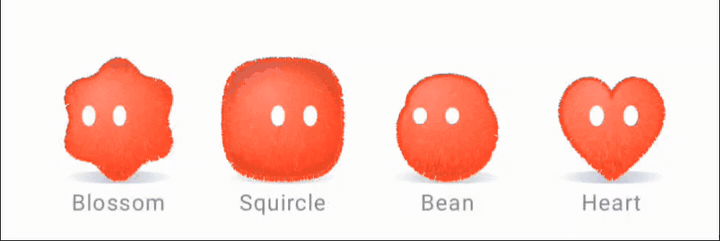

# Interactive Bot UI

**An animated, touch-reactive bot avatar for native Android (Jetpack Compose) and iOS (SwiftUI).**
A fluffy mascot with 17 moods, drawn natively: no web view, no Lottie, no video files. Use it as the
face of an AI assistant, chatbot, voice assistant, onboarding guide or loading state, and recolour it
or change its mood at runtime.

Looking for a Lottie alternative, an animated mascot or an AI assistant avatar for Jetpack Compose and
SwiftUI? This is a native, code-drawn option with no animation files to ship. Website:
https://knowamit.github.io/interactive-bot-ui/



[](https://github.com/knowamit/interactive-bot-ui/actions/workflows/ci.yml)
[](LICENSE)


## Why use it

- **Native on both platforms.** Jetpack Compose `Canvas` on Android, SwiftUI `Canvas` on iOS. Same
  design, same motion constants, same API shape on both.
- **17 moods.** Happy, Thinking, Idea, Love, Listening, Speaking, Success, Error and more. Switch with
  one parameter and the face crossfades.
- **Made for assistant UIs.** Listening, Thinking and Speaking states map directly onto a voice or chat
  assistant's turn-taking.
- **Touch reactions built in.** Tap to giggle, press and hold for love.
- **Fully styleable.** Any colour, fur length and density, brightness, six built-in body shapes, plus your own
  shape from an SVG path.
- **Custom faces.** Mix 7 eye styles and 10 mouth styles to build any expression.
- **Dependency-light.** Plain Kotlin and Swift. Android needs only AndroidX Compose, iOS only SwiftUI.
- **Respects accessibility.** Animation stops when the system reduces motion.

## What is included

| Part | Options |
| --- | --- |
| Body shapes (6) | Teardrop (default), Round, Egg, Blob, Blossom, Squircle |
| Custom body | any SVG path via `BotShape.svg(...)` (the demo apps add Bean and Heart this way) |
| Eyes (7) | Oval, ArcUp, ArcDown, Heart, Star, Cross, Slit |
| Mouths (10) | None, Smile, Grin, Open, O, Flat, Frown, Wavy, Dot, Talk |
| Face mode (2) | Eyes, EyesAndMouth |
| Moods (17) | Neutral, Happy, Working, Sleeping, Thinking, Idea, Love, Sad, Surprised, Angry, Confused, Excited, Listening, Speaking, Success, Error, Giggle |
| Badges | thought bubble (Thinking), light bulb (Idea) |
| Style knobs | colour, brightness, fur length, fur density |
| Face knobs | `eyeScale`, `eyeScaleRight`, `eyeTilt`, `lookX`, `lookY`, `mouthScale`, `mouthShift` |
| Touch | tap = giggle, press and hold = love |

## Install

### Android (Gradle)

minSdk 24, Jetpack Compose. Published through JitPack:

```kotlin
// settings.gradle.kts
dependencyResolutionManagement { repositories { maven("https://jitpack.io") } }

// app/build.gradle.kts
implementation("com.github.knowamit:interactive-bot-ui:0.2.0")
```

Or include the module directly: copy `android/botui` and add `include(":botui")`.

### iOS (Swift Package Manager)

iOS 16+, SwiftUI. In Xcode use File > Add Package Dependencies and enter
`https://github.com/knowamit/interactive-bot-ui`, or in `Package.swift`:

```swift
.package(url: "https://github.com/knowamit/interactive-bot-ui", from: "0.2.0")
```

Then `import BotUI`.

## Quick start

### Android (Jetpack Compose)

```kotlin
import dev.botui.*

BotView(
    state = BotState.Happy,            // see States below
    modifier = Modifier.size(260.dp),
    style = BotStyle(
        color = Color(0xFFF5292A),
        brightness = 1.1f, furLength = 2.6f, furDensity = 0.75f,
        face = BotFace.EyesAndMouth,   // or Eyes
    ),
)
```

Module `android/botui`. Demo app: `android/app`. Build: `cd android && ./gradlew :app:assembleDebug`.
Tests: `:botui:testDebugUnitTest`.

### iOS (SwiftUI)

```swift
import BotUI

BotView(
    state: .happy,                       // see States below
    style: BotStyle(color: Color(red: 0.96, green: 0.16, blue: 0.16),
                      brightness: 1.1, furLength: 2.6, face: .eyesAndMouth))
    .frame(width: 260, height: 260)
```

Swift package at the repo root. Demo app: `ios/Demo` (`xcodegen generate`, then open the project).
Tests: `swift test` at the repo root.

## Demo apps

Both demos show every body shape in one horizontal row (four visible at a time, swipe for the rest)
and drive them all from the same controls: mood, colour, brightness, fur length, mouth and custom face.
Tap a bot to giggle, hold for love.

## Use it as an AI assistant avatar

Map your assistant's phases to states:

| Assistant phase | State |
| --- | --- |
| Idle | `Neutral` |
| Listening to the user | `Listening` |
| Waiting for the model | `Thinking` |
| Speaking a reply | `Speaking` |
| Got a good idea | `Idea` |
| Task finished | `Success` |
| Something failed | `Error` |

```kotlin
BotView(state = when (phase) {
    Phase.Listening -> BotState.Listening
    Phase.Thinking  -> BotState.Thinking
    Phase.Speaking  -> BotState.Speaking
    else            -> BotState.Neutral
})
```

## States

17 presets, same names on both ports (Swift uses lowerCamel):

Neutral, Happy, Working, Sleeping, Thinking, Idea, Love, Sad, Surprised, Angry, Confused, Excited,
Listening, Speaking, Success, Error, Giggle.

Each state is a face preset (`BotFaceSpec`) plus a body motion (hop, shake, nod, heartbeat, tilt,
giggle wiggle). Changing state crossfades the old face into the new one over about 0.22s. No face
uses eyebrows. Sad and Angry tilt the eyes instead (`eyeTilt`).

Thinking shows a thought bubble with pulsing dots, and Idea shows the system light bulb emoji with
pulsing rays, both floating beside the head.

## Touch

Tap the bot to make it giggle (1.6s), press and hold for love (2.4s). Then it returns to the state you set.

```kotlin
BotView(state, touchReactions = true, onTouch = { reacted -> /* Giggle or Love */ })
```

```swift
BotView(state: state, touchReactions: true, onTouch: { reacted in /* .giggle or .love */ })
```

Pass `touchReactions = false` to turn it off.

## Body shape

Built-in shapes: Teardrop (default), Round, Egg, Blob, Blossom, Squircle.

```kotlin
style = BotStyle(shape = BotShape.Round)
style = BotStyle(shape = BotShape.svg("M20 40C20 10 80 10 80 40C95 55 85 95 50 95C15 95 5 55 20 40Z"))
```

```swift
BotStyle(shape: .round)
BotStyle(shape: .svg("M20 40C20 10 80 10 80 40C95 55 85 95 50 95C15 95 5 55 20 40Z"))
```

`svg` takes the first sub-path of any SVG path string (`M L H V C S Q Z`, absolute or relative, any
units, no arcs). It is scaled to fit and stands on the ground. A bad path falls back to the teardrop.
Fur and shading follow the shape. The demo apps also include Bean and Heart shapes made this way.

## Custom face

Build any state by passing your own face through the style. A custom face replaces the state's face
(motion still follows `state`).

```kotlin
style = BotStyle(customFace = BotFaceSpec(
    eyes = BotEyes.Star, mouth = BotMouth.Open, eyeScale = 1.2f, eyeTilt = -0.4f))
```

```swift
BotStyle(customFace: BotFaceSpec(
    eyes: .star, mouth: .open, eyeScale: 1.2, eyeTilt: -0.4))
```

Eye and mouth names are listed in [What is included](#what-is-included) (Swift spells the empty mouth
`.none`). `eyeTilt` runs -1 (angry) to 1 (sad) and turns oval and slit eyes.

## Layout note

The bot has no built-in margin on Android, so badges such as the light bulb and the hop float past the
top of the body. Leave some room above the head (the demo uses about 24dp).

## Parity

Both ports share the same sim constants (seeded mulberry32, hop, blink, gaze), body path and
shading. Fur is a close approximation, not a pixel match across platforms.

## See also

- [bloub](https://github.com/jeremy-prt/bloub): a web (Vue and SVG) recreation of the x.ai bot avatar,
  with an animation editor and GIF/MP4 export. Interactive Bot UI is a different project: a native
  Jetpack Compose and SwiftUI library with its own furry design and no shared code.

## Contributing

Issues and pull requests are welcome. Run the tests before opening a PR: `swift test` at the root and
`cd android && ./gradlew :botui:testDebugUnitTest`.

## License

MIT, see [LICENSE](LICENSE).
